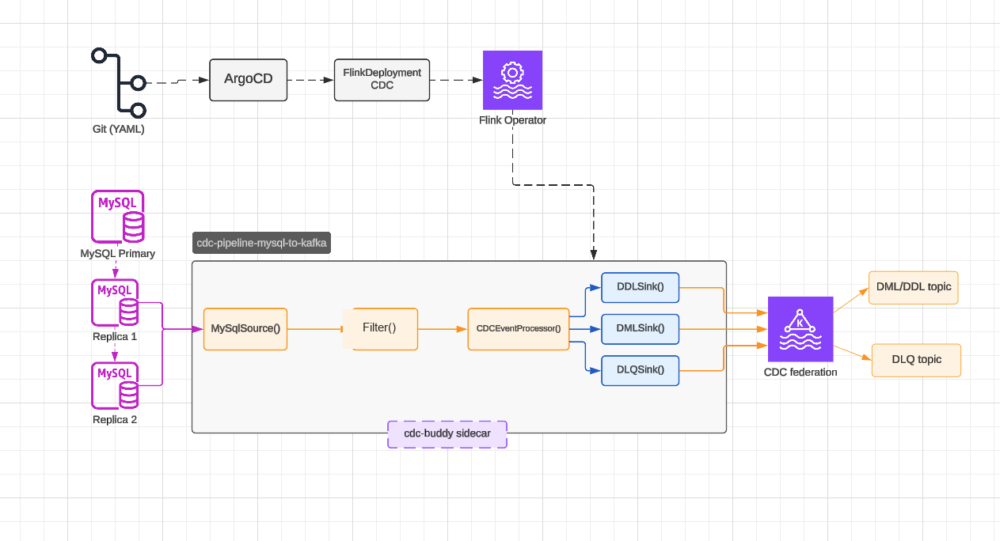
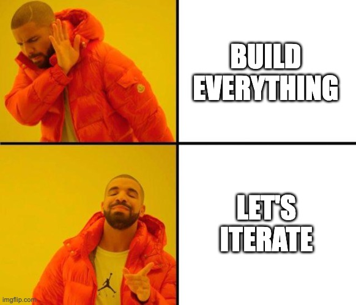
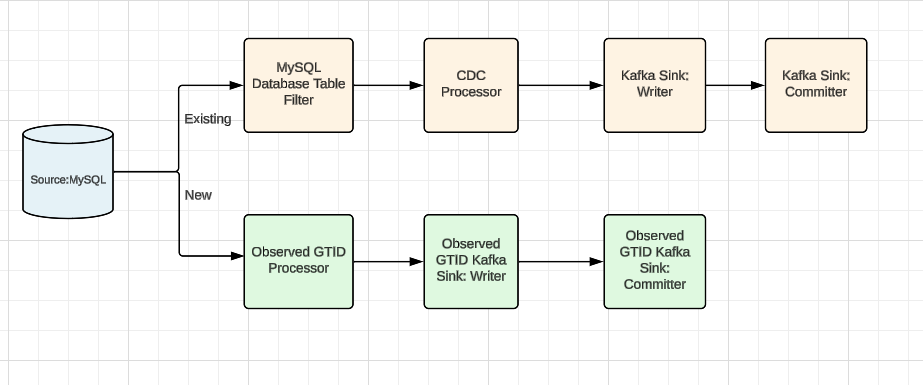
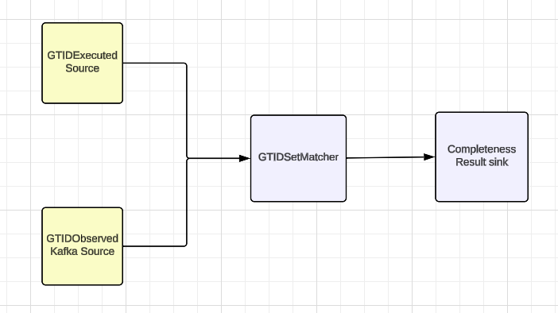
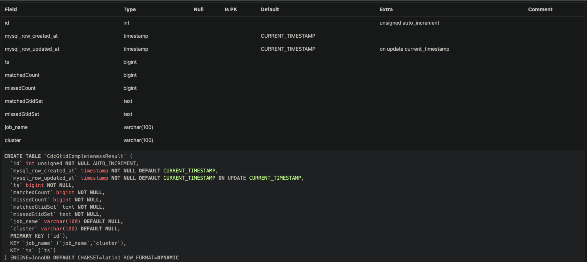
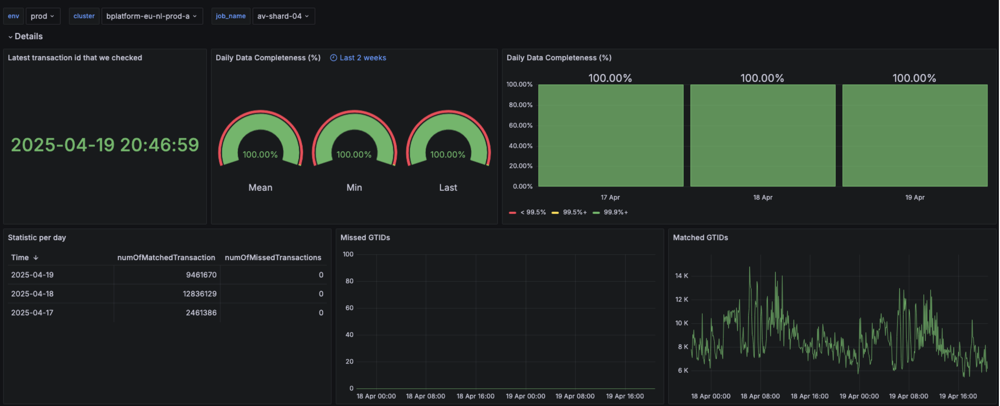
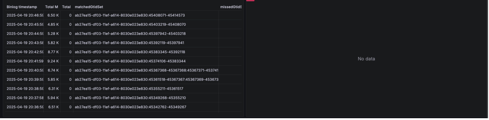

## About Me

### Abhishek Jain

*"Lazy engineer, always trying to find smarter ways to do monotonous jobs"*

 

---

<!-- _class: lead invert -->

# Reliability of our Streaming Pipelines

### How we took Streaming Pipelines Reliability
### from 92% to 99.78%

---

## The Pillars We Think About

When we build any system, we reason about these individually:

- **Scalability**: can it handle more load without falling over?
- **Availability**: is it up when something calls on it?
- **Consistency / Reliability**: is the data correct and complete?
- **Latency & Throughput**: how fast, and how much?

 

> We did too. But for our clients, one of these mattered more than the rest.

---

## Why We Needed Streaming Pipelines

Your service writes to two places: the database, and something downstream, Kafka, a search index, a cache.

Two separate writes, two separate chances to fail:
- DB write succeeds, downstream write fails → **silent drift**
- Downstream write succeeds, DB write fails → **phantom data**

No single atomic transaction covers both writes, and neither write tells you the other one's outcome. If it fails, you get silence, not a signal.

 

**This is the problem Change Data Capture (CDC) exists to solve.**

---

## What is CDC?

**Change Data Capture**: capture every row-level change in a database as it happens, and stream it out to whatever needs to react to it. The pieces below are how we do that on top of MySQL:

- **Binlog**: MySQL's own append-only log of every row change; already the source of truth for replication
- **GTID** (Global Transaction Identifier): a unique ID MySQL stamps on every committed transaction; lets you ask any replica "have you seen this one?" It's the building block completeness checking is built on. Needs `gtid_mode=ON`, which MySQL replication already uses, so it comes for free
- **GTID set**: one or more single GTIDs or ranges of GTIDs, e.g. `3E11FA47-71CA-11E1-9E33-C80AA9429562:1-3:11:47-49`. This is what gets compared, not individual GTIDs one by one
- **Debezium**: reads the binlog, turns raw replication events into structured change records
- **Flink**: the streaming engine running the CDC job: consumes the binlog stream, applies logic, writes out
- **Sink**: where changes land: Kafka, S3, or others, depending on the consumer

 

**Quick vocabulary check:** database → table → row. **DDL** changes structure (`CREATE`, `ALTER`), **DML** changes data (`INSERT`, `UPDATE`, `DELETE`). CDC has to handle both.

---

## Current Architecture: Main Pipeline

One job per MySQL instance, configurable to capture **every table** or a **specific subset**. Reads from binlog replicas, processes events through operators (`MySqlSource → Filter → CDCEventProcessor`), writes to DDL/DML/DLQ sinks feeding Kafka. Sidecar (`cdc-buddy`) runs alongside the job.

GitOps deployment end to end: desired state lives in **Git**, **ArgoCD** reconciles it, the **Flink Operator** turns the `FlinkDeployment` CRD into a running job on Kubernetes.

---

## Current Architecture: Completeness Setup

<pre class="mermaid">
flowchart LR
    DB[(MySQL)] --> BR[Binlog Reader]
    BR --> EP[Events Producer]
    EP --> K[(Kafka)]
    DB -.->|count| SMC[Source Metrics Collector]
    K -.->|count| SKMC[Sink Metrics Collector]
    SMC --> MS[(Metrics Storage)]
    SKMC --> MS
</pre>

How we measured reliability before: compare **message counts** on the source side vs the sink side.

---

## The Reliability Problem

Two separate problems, easy to conflate, and we did:

- **Detection was broken.** At-least-once delivery means duplicates exist. Comparing total message counts (source vs sink) can still "match" even when real transactions are missing; a duplicate elsewhere silently offsets a real miss. The count check wasn't measuring completeness at all; it just felt like it was.
- **Recovery was time-boxed.** Binlog / topic retention: **3 days** (longer retention costs storage and adds maintenance overhead). Even once a miss *is* caught, if it's outside that window, the data behind it is already gone: unfixable, not just delayed.

**~92% reliability.** Not good enough for Fintech-grade consumers.

 

**Retention didn't cause the misses; it's why, once counting hid them past the window, they became permanent.**

---

## The Goal

Solve completeness **end to end**: not just "did we read everything from MySQL," but "did everything we read actually make it to the sink."

- **Source-side completeness**: every transaction MySQL accepted was consumed
- **Sink-side completeness**: every transaction consumed was correctly published

 

Both sides needed a real answer, not a spot check. And it's not just an internal metric: it's what lets us tell our customers, with evidence, that their data made it through.

---

## New Architecture: End-to-End

<pre class="mermaid">
%%{init: {"flowchart": {"nodeSpacing": 8, "rankSpacing": 18, "subGraphTitleMargin": {"top": 8, "bottom": 6}}, "themeVariables": {"fontSize": "12px"}}}%%
flowchart TB
    MYSQL[("MySQL replica binlog")]
    GTIDCOL["GTID collector"]
    MYSQL --> GTIDCOL

    subgraph JOB["CDC-to-Kafka"]
      direction LR
      RB["Read binlog"] --> RM["RecordMakers.java"] --> DOTS["..."] --> KS0["KafkaSink"]
      GG1["GTIDGatherer1"] --> KS1["KafkaSink"]
      GG2["GTIDGatherer2"] --> KS2["KafkaSink"]
      RB -.-> GG1
      DOTS -.-> GG2
    end
    MYSQL -.-> RB

    GTIDCOL --> T_EXEC[["GTID_EXECUTED topic"]]
    KS1 --> T_OBS[["GTID_OBSERVED topic"]]
    KS2 --> T_DEBEZ[["DEBEZ_GTID_OBSERVED topic"]]
    KS0 --> T_MSG[["CDC_MESSAGES topic"]]

    subgraph GTIDC["gtid-completeness"]
      direction TB
      GES["GTID_EXECUTED Source (diffForTimeRange)"]
      GOS["GTID_OBSERVED Source"]
      VAL1["Validate"]
      GMS["GTID_MetricSink"]
      GES --> VAL1
      GOS --> VAL1
      VAL1 --> GMS
    end

    subgraph CDCC["cdc-completeness"]
      direction TB
      DGS["DEBEZ_GTID_OBSERVED Source"]
      CMS_S["CDC_MESSAGES Source"]
      VAL2["Validate"]
      CMS["CDC_MetricSink"]
      DGS --> VAL2
      CMS_S --> VAL2
      VAL2 --> CMS
    end

    T_EXEC --> GES
    T_OBS --> GOS
    T_DEBEZ --> DGS
    T_MSG --> CMS_S

    GMS --> RESULT["CDC_COMPLETENESS_RESULT sink"]
    CMS --> RESULT

    classDef job fill:#ffc966,stroke:#cc8800,color:#1a1a1a
    classDef topic fill:#c6e86b,stroke:#7a9b2e,color:#1a1a1a
    classDef inner fill:#fff4d6,stroke:#cc8800,color:#1a1a1a
    classDef source fill:#cfe8ff,stroke:#4a90d9,color:#1a1a1a
    classDef sink fill:#d9c6f5,stroke:#7a4fae,color:#1a1a1a
    class JOB,GTIDC,CDCC,GTIDCOL job
    class T_EXEC,T_OBS,T_DEBEZ,T_MSG topic
    class RESULT sink
    class RB,RM,DOTS,KS0,GG1,KS1,GG2,KS2,GES,GOS,VAL1,GMS,DGS,CMS_S,VAL2,CMS inner
    class MYSQL source
</pre>

Two new `GTIDGatherer` branches tap the CDC job: **GTIDGatherer1** off `Read binlog` → **GTID_OBSERVED**; **GTIDGatherer2** off the later `[...]` stage → **DEBEZ_GTID_OBSERVED**. A standalone **GTID collector** polls MySQL for **GTID_EXECUTED**. `gtid-completeness` is built; `cdc-completeness` is still ahead. `diffForTimeRange` diffs GTID_EXECUTED against GTID_OBSERVED within a rolling time window instead of all history, keeping the check fast.

---

## Incremental Strategy

Build the whole thing, source *and* sink completeness, up front? Or start smaller and learn?

- Started with **source-side (GTID) completeness only**
- Reasoning: it would surface unknowns before committing to the full design, and might already be enough on its own to tell us how reliable the platform really is
- Feedback loop first, full scope later: sink-side (CDC-completeness) comes next, informed by what we learn here

---

## New Architecture: Main Job, Updated

The CDC job now also emits **Observed GTID**, every transaction it read from the binlog, down its own Kafka sink branch.

---

## New Architecture: Completeness Job

A separate Flink job consumes both **GTIDExecuted** (source of truth, from MySQL) and **GTIDObserved** (from the main job's new branch). The **`GtidSetMatcher`** operator compares the two sets and writes anything missing to the **Completeness Result sink**.

This is the half we shipped: just source-side (GTID) completeness, the **left side** of the end-to-end picture. `cdc-completeness`, validating the actual Kafka messages and not just GTIDs, is the incremental step still ahead.

---

## Implementation Details

Results land in a **MySQL sink** (`CdcGtidCompletenessResult`), deliberately simple, and it plugs straight into Grafana's MySQL datasource.

---

## Displaying on Grafana

One panel set per completeness pipeline, per MySQL schema. Alerts fire on:
- Missed transactions **> 0** within a **3-hour** window (gives lagging transactions time to catch up)
- Matched events **= 0** within a **30-minute** window (pipeline down, Kafka not getting events, or can't reach MySQL). Short on purpose: a false alarm is better than a late one

---

## Grafana: Per-Transaction Detail

Binlog timestamp, matched/missed GTID sets per minute; drill-down from the summary panels before.

---

## Results

92% → 99.78%

raw source-side completeness, gaps caught and reconciled to 100% within the week

mean across ~30 pipelines (~25 schemas), averaged weekly over 3+ months

 

Good enough for Fintech-grade consumers to build on.

---

## Scaling & High Availability

- **Kubernetes autoscaling**: pods scale automatically with load, already running in production
- Migrated to a **K8s IOPS (Input/Output Operations Per Second) cluster** for better throughput
- **Kafka partition increases** to relieve both producer and consumer bottlenecks
- **TaskManager scale-up per pipeline**: still a manual step today
- **High availability**: **JobManager HA via ZooKeeper**, for both main and completeness pipelines. If a cluster fails, a standby JobManager starts in another cluster and brings up the TaskManager pods, so no single cluster failure takes completeness checking down with it

---

## What Went Well, Learnings & What Needs to Improve

**Went well:**
- Starting with source-side (GTID) completeness alone already moved the needle: we didn't need the full solution to get real signal
- MySQL sink + Grafana was the right call for the completeness results: simple, no new tooling to operate
- High availability paid off: a cluster or AWS AZ going down didn't need manual recovery, and didn't cause completeness misses

**Learnings:**
- **Check identity, not counts.** Counts hide misses when duplicates exist. GTIDs do not.
- **Detection alone does not raise reliability.** It shows you where to fix. Scaling and HA were part of the fixing.

**Needs to improve:**
- One completeness pipeline per main pipeline doesn't scale: every new main pipeline still needs its own completeness setup built and maintained

---

## Roadmap

- **POC in progress: merge all completeness checks into one pipeline**, one job consuming multiple schemas/tables/topics and reporting across all of them, instead of a new pipeline per schema.

| | Separate pipelines (today) | Merged pipeline (POC) |
|---|---|---|
| Ops overhead | New pipeline per schema | One pipeline, config-driven |
| If it goes down | Only that schema shows 0% | Every schema it covers shows 0% |
| Data actually lost | None | None (3-day retention, always replayable) |

- **Per-transaction counting** (via Debezium's transaction metadata): checks that *every query inside* a transaction was processed, not just the transaction as a whole. Next lever: **99.78% → 99.9%**.

---

<!-- _class: lead invert -->

# Questions?
