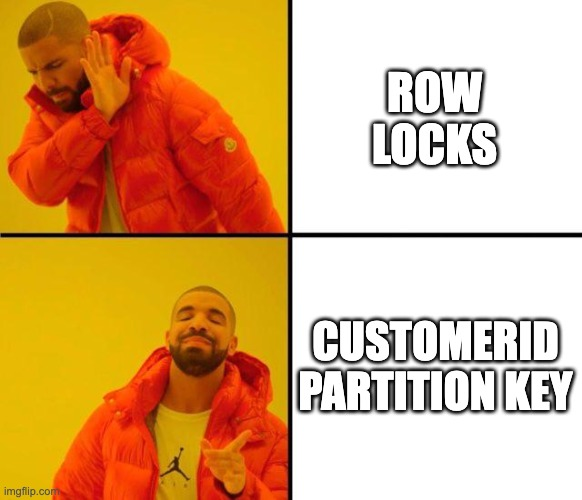
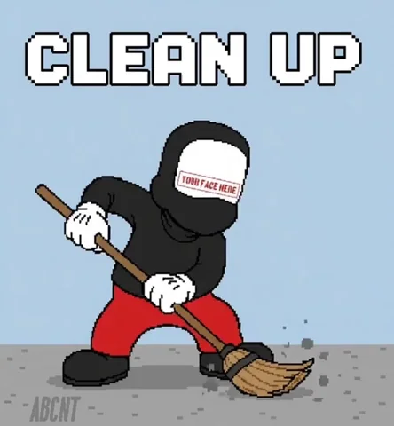

<script src="https://cdn.jsdelivr.net/npm/mermaid@10/dist/mermaid.min.js"></script>
<script>mermaid.initialize({ startOnLoad: true, theme: 'dark' });</script>

## About Me


### Abhishek Jain

*"Lazy engineer, always trying to find smarter ways to do monotonous jobs"*

<br/>


---

<!-- _class: lead invert -->

# Kafka for Everything

### How we handle concurrent financial transactions at scale —
### without a database lock in sight

---

## Two payments. Same customer. Same millisecond.


A customer triggers a deposit and a withdrawal at the same time.

Both requests arrive at your service simultaneously.
Both need to **read** the current balance, **modify** it, **write** it back.

<br/>

**What happens?**

---

## The Classical Answer

Row-level locks in SQL:

```sql
BEGIN TRANSACTION
SELECT balance FROM accounts WHERE customer_id = ? FOR UPDATE
UPDATE accounts SET balance = balance - 100 WHERE customer_id = ?
COMMIT
```


It works — but the **database is the chokepoint**:

- Every concurrent write for the same customer queues at the DB
- DB goes slow → your service goes slow. DB goes down → your service goes down
- No audit trail, no "what was the state at time T?"
- Horizontal scaling doesn't help — one writer, always

---

## Kafka Primer: Data Model

- **Topic** — a named, durable, ordered log of events
- **Partition** — a topic split into N independent ordered logs
  - Messages with the same **key** always go to the **same partition** — for a fixed partition count
  - Order guaranteed *within* a partition, not across partitions
- **Offset** — each message's monotonically increasing position within a partition
- **Compaction** — Kafka retains only the **latest message per key** → a topic becomes a key-value store

<br/>

> **Our setup**: self-managed Kafka on EC2, dedicated EBS volumes per broker, ZooKeeper, JMX → Prometheus. Full operational ownership.

---

## Kafka Primer: Consumer Model

- **Consumer Group** — N consumers sharing the work; each partition assigned to exactly **one consumer at a time**
  - Key insight: one consumer per partition = natural serialization

- **Reset Policies** — where a consumer starts when it has no committed offset:
  - `earliest` — replay from the beginning *(state topics)*
  - `latest` — skip to new messages only *(input/request topics)*
  - `last` *(custom)* — only the single latest message *(snapshot topics)*

- **Delivery** — at-least-once; services are designed to be idempotent where possible

---

## Topic Design: Partitioning



> "Concurrent requests for the same customer still queue — but sequencing is Kafka's job now, not yours. No locks, no retry logic, no DB as the chokepoint."

- **64 fixed partitions** across every topic in the system
  - Fixed forever — changing partition count reroutes keys, breaking ordering guarantees
  - 64 chosen to balance parallelism vs operational overhead

- **Input topic partitioned by `CustomerId`** — routes all requests for a customer to partition N
- **Downstream topics maintain partition alignment by producer discipline** — every service writes back to the same partition it consumed from; the message key serves record identity (e.g. `payment_id`), not routing
  - One consumer per partition = one thread of execution per customer slice
  - Concurrent requests for the same customer queue naturally in Kafka order
  - Partition decided once at entry by `CustomerId` hash; downstream services write back to the consumed partition directly — no re-hashing

- **Batch processing** — consumers poll in batches; two deposits in quick succession may land in the same poll
  - Each is still independent: own payment ID, wallet block, state update
  - Downstream publishes are also batched → fewer round-trips, higher throughput per partition

---

## System Overview

<pre class="mermaid">
flowchart LR
    C([Client])
    GW[Gateway]
    KF{{Kafka}}
    P[Processor]
    J[Joiner]
    SK[Sinker]
    DS[(Stores)]

    C <-->|SSE| GW
    GW <-->|req/reply| KF
    KF -->|consume| P
    P -->|state| KF
    KF -->|consume| J
    J -->|enriched| KF
    KF -->|consume| SK
    SK --> DS
</pre>

64 partitions · input keyed by CustomerId · no service calls another directly

---

## Gateway: The Hard Boundary

<div style="display:flex; gap:2rem; align-items:flex-start;">
<div style="flex:1;">

- **OpenAPI spec as routing config** — each endpoint declares which Kafka topic it maps to; the spec is not just documentation, it's operational config
- **Reply-topic injection** — gateway adds a `reply-topic` header to every outgoing message; downstream knows where to respond without the client being involved
- **`produced-by` header** — every message carries its origin; distributed tracing baked into the message, not a separate system

> Clients are fully decoupled from internal topology. Fire a request, wait on SSE. The rest is Kafka.

</div>
<div style="flex:0 0 42%;">
<pre class="mermaid">
flowchart LR
    C([Client]) <-->|SSE| GW[Gateway]
    GW -->|req + reply-topic| KF{{Kafka}}
    KF -->|reply| GW
</pre>
</div>
</div>

---

## In-Memory State: The Idea

<div style="display:flex; gap:2rem; align-items:flex-start;">
<div style="flex:1;">

- State changes published to a **state topic** — the source of truth
- The in-memory store is an ephemeral projection of that topic
- Each consumer owns a fixed partition slice — in-memory state covers only that slice, not all customers
- Service crashes → restart → rebuild from Kafka
- Request handling = a map lookup, not a DB read

The tradeoff: startup time. Every restart replays the full state topic from offset 0 — weeks or months of events before the service can handle a single request. Which leads us to snapshots.

</div>
<div style="flex:0 0 40%;">
<pre class="mermaid">
flowchart LR
    IK[Input] -->|consume| P[Processor]
    P -->|read/write| MEM[(Memory)]
    P -->|state| ST[State]
</pre>
</div>
</div>

---

## Snapshot Pattern: Steady State

**Parter** watches the state topic and periodically serialises the full in-memory state as a single snapshot message — triggered by min offset diff or max time elapsed.

<pre class="mermaid">
flowchart LR
    subgraph Kafka["Kafka"]
        IK[Input]
        ST[State]
        SNP[Snapshot]
    end
    subgraph App["App"]
        MEM[(Memory)]
    end
    PA[Parter]
    IK -->|consume| App
    App -->|update| MEM
    App -->|state| ST
    ST -->|reads| PA
    PA -->|snapshot| SNP
</pre>

---

## Snapshot Pattern: Cold Start

<pre class="mermaid">
sequenceDiagram
    participant SNP as Snapshot
    participant ST as State
    participant MEM as Memory
    participant IK as Input

    rect rgb(30, 60, 110)
        Note over SNP,IK: Processing App — cold start
        SNP-->>MEM: 1. Read last snapshot → seed memory
        ST-->>MEM: 2. Replay delta to tip
        IK-->>MEM: 3. Resume live processing
    end
</pre>

Without snapshots: full state topic replay on every restart.
With snapshots: seed from the last snapshot offset, replay only the **delta**.

> Snapshot is shaped for the in-memory store on write — cold start reads the last message and loads it directly. No transformation on load.

---

## Topic Joining: N→1

<div style="display:flex; gap:2rem; align-items:flex-start;">
<div style="flex:1;">

**How it works:**
- Joiner consumes N input topics under one consumer group
- Tracks the latest "fragment" per key in-memory
- When all required fragments for a key are present → emits a merged record to the output topic
- Optional fragments become `null`; tombstone on any input → tombstone propagated

**The key guarantee:** all topics use the same partition count, and every service **writes back to the same partition it consumed from** — not by consistent key hashing, but by producer discipline.

**No framework.** No Flink, no Kafka Streams. Consumers + an in-memory merge map + a producer.

</div>
<div style="flex:0 0 40%;">
<pre class="mermaid">
graph LR
    T1[Wallet] --> J[Joiner]
    T2[Payment] --> J
    T3[Promo] --> J
    J --> OUT[Enriched]
</pre>
</div>
</div>

---

## Derived Data: Projections

<div style="display:flex; gap:2rem; align-items:flex-start;">
<div style="flex:1;">

**Kafka is the source of truth. DynamoDB and OpenSearch are derived projections — query-optimised views of the same data.**

Stateless transform consumers. No snapshot needed. Adding a new store = deploy a new sinker; producers and topics untouched.

</div>
<div style="flex:0 0 50%;">
<pre class="mermaid">
flowchart LR
    subgraph Kafka["Kafka"]
        ST[State]
    end
    ESSINK[ES Sink]
    DBSINK[DDB Sink]
    SFSINK[SF Sink]
    subgraph Stores["Stores"]
        OS[(OpenSearch)]
        DDB[(DynamoDB)]
        SF[(Snowflake)]
    end
    ST --> ESSINK
    ST --> DBSINK
    ST --> SFSINK
    ESSINK --> OS
    DBSINK --> DDB
    SFSINK --> SF
</pre>
</div>
</div>

---

## Ops



**Cleaner (`clener`)**
State topics grow forever without intervention. Clener runs at a configured interval, one partition at a time (with a time gap) — reads snapshot → identifies stale records → produces tombstones to the state topic. Tombstone on a compacted topic = Kafka eventually removes the key entirely.

**Consumer Lag**
The key SRE metric: how far behind a consumer group is from the tip of a partition. Lag spike = consumer slow or stuck → alert on this. Cold start spike is normal; lag drains as bootstrap completes.

**kafcli — custom internal CLI**
OAuth2 + no direct VPN = standard Kafka tools don't work. kafcli + kafoxy: grep with boolean logic, time-based offsets, trace mode (orders messages by timestamp across partitions), ad-hoc queries, partition lookup by key.

---

## Putting It All Together

<pre class="mermaid">
flowchart LR
    C([Client])
    GW[Gateway]
    KF{{Kafka}}
    P[Processor]
    PA[Parter]
    J[Joiner]
    SK[Sinker]
    CLN[Clener]
    DS[(Stores)]

    C <-->|SSE| GW
    GW <-->|req/reply| KF
    KF -->|consume| P
    P -->|state| KF
    KF -->|reads| PA
    PA -->|snapshot| KF
    KF -->|consume| J
    J -->|enriched| KF
    KF -->|consume| SK
    SK --> DS
    CLN -.->|tombstones| KF
</pre>

> Each arrow through Kafka is a separate topic — this is the pattern, not a single stream.

---

## Config-Driven Generics


> *"That's a lot of services — parter, joiner, essink, clener..."*

Yes. But because all topics share the same layout — same partition count, same key, same bootstrap pattern — these are **generic reusable images deployed via config**.

- One `parter` image → runs for every state topic in the system, different env vars
- One `essink` image → handles every OpenSearch index, field mappings in config
- One `joiner` image → handles every N→1 join, topic list in config
- One `clener` image → handles every cleanup schedule, topic + age in config

**The standard layout is what makes this cheap, not expensive.**

---

## Why Not Flink / K8s+DB?

**Why not Flink:**
- **Wrong tool** — Flink's value is windowing, aggregations, joins over time; our use case is stateful event-at-a-time processing; we'd be using it as an expensive consumer loop
- **Operational surface we don't own** — Flink operator, CRDs, checkpoints, savepoints, RocksDB; none of this is Kafka or k8s which our teams already operate; it's a new discipline, not an extension
- **Doesn't scale across a vertical** — pattern runs across multiple teams; Flink requires specialist knowledge that doesn't distribute at that scale; a Kafka consumer loop does

**Why not K8s services + traditional DB:**
- DB becomes the serialization chokepoint — back to the concurrent transaction problem
- Two-system failure: DB down → service down
- No audit trail, no replay, no "what was the state at time T?" — not out of the box; CDC, event streams, snapshots are all possible but need to be built and operated separately

---

## What You Get Instead


- **Rebuildable state & free replay** — state is a projection; reset to offset 0 and it rebuilds exactly
  - *Replay saved us*: moved all players to a new payment provider by dumping records to a topic — no migration tool, no DB script
- **Failure isolation & no cascading failures** — a service crashing means lag, nothing else
  - *PSP down*: requests queue, no lost money. *Sink down*: catches up, zero data loss. *Any service down*: lag drains on recovery — no circuit breaker needed
- **No inter-service calls** — one service going down cannot take down its callers
- **No dual-write inconsistency** — one write target; derived stores always consistent by construction
- **No saga pattern** — no distributed transactions to coordinate
- **One pattern across every team** — every service looks the same: consume a topic, produce a topic
- **Standard layout pays compound interest** — every constraint unlocks the next pattern; feels restrictive early, pays off continuously

---

## Lessons: Regrets

**Things we'd do differently:**
- **In-memory state size** — large state domains need a non in-memory data store as snapshot backend to avoid memory pressure
- **Cold start chain** — too many topics before going live; one slow partition stalls the whole chain; complexity grows with every new topic
- **Tombstone-based deletes** — clener + tombstones + compaction is significant machinery for "delete a record"; lifecycle is non-trivial to reason about
- **Fixed partition count** — 64 can never increase without rebuilding all topics; parallelism ceiling even if you scale services horizontally
- **Long outage catch-up** — in HTTP, requests drop during an outage; in Kafka, they accumulate. On recovery: process the backlog (delayed go-live) or skip to latest (lose it).

**Things we'd like but don't have yet:**
- **Schema registry** — schema changes coordinated by convention across teams; a registry would enforce contracts and make cross-team consumption safer

---

<!-- _class: lead invert -->

# Questions?
